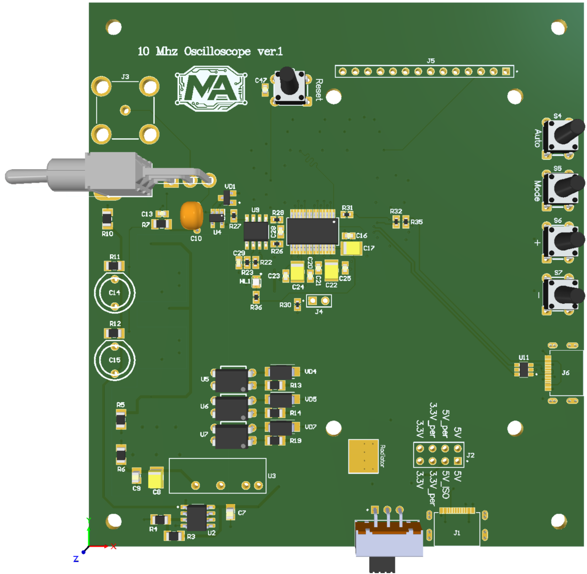
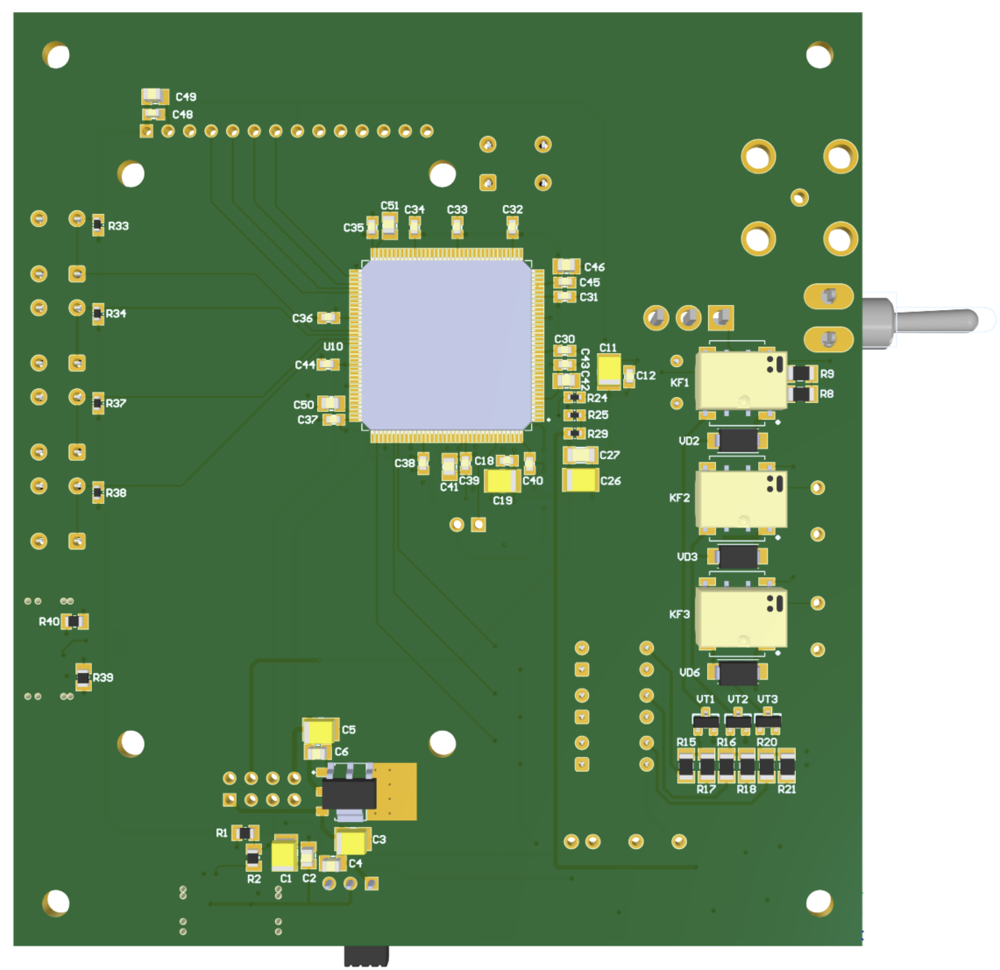
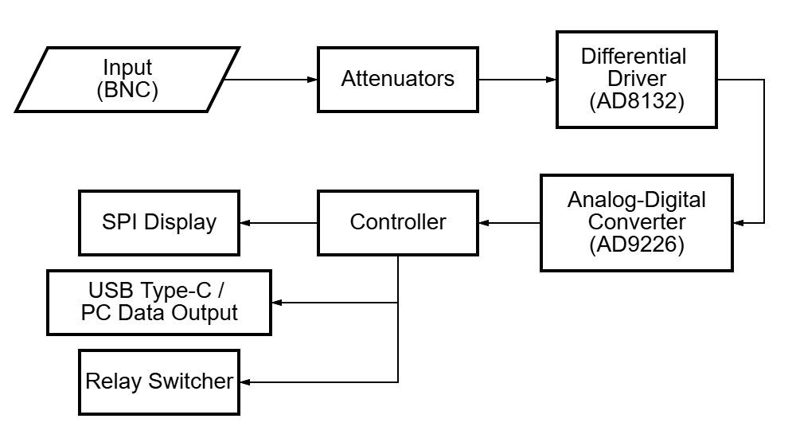
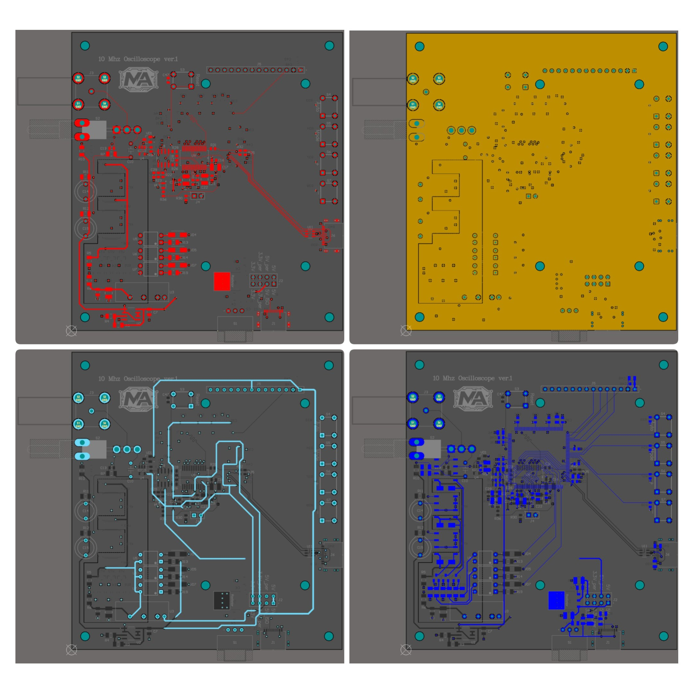

# 10 MHz STM32 Digital Oscilloscope

A custom-designed digital oscilloscope based on the **STM32H723ZGT6**
microcontroller and **AD9226 12-bit ADC**.

The project is designed as a compact standalone oscilloscope with a
high-speed analog front-end, selectable relay-based input attenuation,
parallel ADC acquisition and an SPI TFT display.

  

Figure 1. 3D view of Top side PCB 

  

Figure 2. 3D view of Bottom side PCB 

## Overview

The main goal of this project is to design a digital oscilloscope
completely from scratch — including the analog front-end, ADC interface,
power supply, relay control, PCB and firmware.

The oscilloscope architecture is based around:

- STM32H723ZGT6 MCU
- AD9226 12-bit ADC
- AD8132 differential ADC driver
- OPA356 high-speed operational amplifier
- Relay-based input attenuation
- STM32 PSSI parallel data interface
- 2.4" 240×320 SPI TFT display
- USB Type-C interface with PC data output

The oscilloscope provides the ability to transfer measurement data and results to a computer via USB Type-C for further analysis and processing.
The target measurement bandwidth is up to 10-12 MHz.

## Main Specifications

| Parameter | Value |
|---|---|
| MCU | STM32H723ZGT6 |
| ADC | AD9226, 12-bit |
| ADC interface | 12-bit parallel |
| MCU acquisition interface | PSSI + DMA |
| ADC driver | AD8132 |
| High-speed amplifier | OPA356 |
| Input attenuation | ×1 / ×10 / ×20 |
| Attenuation switching | Relay-controlled |
| Input connector | BNC |
| Target bandwidth | Up to 12 MHz |
| Display | 2.4" 240×320 TFT |
| Display interface | SPI |
| PC connectivity | USB Type-C |
| PC data output | Measurement data transfer via USB |
| Relay supply | Isolated 5 V |
| Isolated DC/DC | B0505S-2W |
| User controls | 4 buttons + AC/DC switch |

> The target bandwidth is a design objective. Final performance characteristics such as bandwidth, SNR, ENOB, sampling rate and overall measurement accuracy will be determined experimentally after hardware validation.

## System Architecture

The analog signal path consists of the input connector, relay-controlled attenuators, differential ADC driver and AD9226 ADC. The STM32H723ZGT6 handles data acquisition, processing and system control, while also providing the display, USB and relay-control interfaces.

  

Figure 3. High-level functional block diagram 

## Circuit Description

### Power supply

The oscilloscope is powered through a USB Type-C connector.

The power supply section includes a jumper-selectable distribution header, allowing individual power circuits to be disconnected during hardware testing, debugging and repair. This makes it possible to isolate selected parts of the board without modifying the PCB.

The main power architecture consists of:

- USB Type-C input providing the main 5 V supply
- Jumper header for selective power isolation during testing and servicing
- AMS1117-3.3 linear regulator for generation of the 3.3 V supply
- 3.3 V rail for the MCU, ADC digital circuitry and SPI display
- Buffered virtual ground generated from the 3.3 V rail for the analog signal path
- Isolated DC/DC converter (B0505S-2W) providing an isolated 5 V supply for the relay switching circuitry
- Local input and output decoupling capacitors for the power rails

The 3.3 V supply generated by U1 is distributed to the main digital circuitry, including the STM32H723ZGT6, the ADC digital supply and the TFT display. The same 3.3 V domain is also used to generate and buffer the virtual ground reference required by the analog front-end.

A separate galvanically isolated 5 V rail is generated by the B0505S-2W converter for the relay switching section. This provides electrical isolation between the relay control circuitry and the main 3.3 V logic domain.

### Input & Attenuators

The input stage is designed to provide a high input impedance, selectable attenuation and signal conditioning before the ADC driver.

The input signal enters through a **BNC connector** and is routed through a relay-controlled attenuation network with three selectable ranges:

- **×1**
- **×10**
- **×20**

The input resistors form the input impedance and voltage-divider networks used to select the appropriate input range. The attenuation is designed to keep the signal amplitude within the operating range of the following analog circuitry, with the signal limited to approximately **1.55–1.6 V** at the attenuator output.

Based on a maximum attenuator output amplitude of approximately **1.6 V**, the corresponding calculated input ranges are:

| Attenuation | Maximum input amplitude | Maximum input voltage (Vpp) |
|---|---:|---:|
| ×1 | 1.6 V peak | 3.2 Vpp |
| ×10 | 16 V peak | 32.3 Vpp |
| ×20 | 32 V peak | 64.5 Vpp |

The input signal is biased around a **1.65 V virtual ground**. This allows bipolar input signals to be processed within the single-supply analog domain while keeping the signal within the maximum **3.3 V** input range of the subsequent circuitry.

The input stage also includes a **BAV199 diode protection network** to protect the analog circuitry against excessive input voltage.

Small adjustable capacitors are used for **input capacitance compensation**, allowing the parasitic capacitance of the input path and attenuation network to be compensated during hardware adjustment.

After the attenuation stage, the **OPA356** is used as a high-speed buffer. Its main purpose is to reduce the effective output impedance of the input network and provide a suitable drive for the following differential ADC driver.

### AD8132 / AD9226 Signal Interface

The oscilloscope uses an AD9226 12-bit analog-to-digital converter with a parallel digital output interface. The ADC is used as the main high-speed acquisition device and converts the conditioned differential analog signal into a 12-bit digital data stream.

The AD9226 operates with a 5 V analog supply and a 3.3 V digital interface. Local 100 nF and 10 µF decoupling capacitors are provided for the supply rails.

The ADC uses a differential input with a nominal 2 Vpp full-scale differential input range. The input signal is supplied by the AD8132 differential driver.

The AD8132 is used as a fully differential driver for the AD9226 ADC. Its gain is determined by the resistor ratio:

- R24 = R25 = 510 Ω
- R28 = R29 = 820 Ω
- Differential gain ≈ 510 / 820 ≈ **0.622**

The signal from the attenuator is therefore reduced to approximately **62.2%** of its amplitude before being applied to the ADC input.

With the maximum attenuator output amplitude limited to approximately **1.6 V peak**, the AD8132 produces a differential output of approximately:

$$
1.6\,\text{V} \times 0.622 \approx 1.0\,\text{V}_{\text{peak}}
$$

or approximately **2.0 Vpp differential**, matching the nominal full-scale differential input range of the AD9226.

The AD8132 output common-mode voltage is set to approximately 2.5 V through the VOCM input. This keeps the differential ADC inputs centered within the ADC's single-supply operating range while allowing the input signal to swing in both positive and negative directions.

The AD9226 provides a 12-bit parallel data output connected directly to the STM32H723ZGT6. The MCU captures the ADC data using the PSSI peripheral with DMA, enabling continuous high-speed acquisition with low CPU overhead.

A 33 Ω series resistor is used in the ADC clock path for signal-integrity control. A 68 pF differential capacitor is placed across the ADC input pair to provide high-frequency filtering and help control the input interface.

### Controller

The oscilloscope is controlled by the **STM32H723ZGT6** microcontroller, which handles ADC data acquisition, signal processing, display output, USB communication and relay control.

The MCU generates the **65 MHz clock for the AD9226 ADC** and captures its 12-bit parallel output through the PSSI interface with DMA.

Measurement results can be displayed on the **2.4" SPI TFT display** or transmitted to a PC via **USB Type-C**.

The oscilloscope is operated using four buttons:

- **AUTO** — automatic adjustment of the measurement time base, voltage scale and trigger synchronization
- **MODE** — selects the parameter to adjust
- **UP / +** — increases the selected value
- **DOWN / −** — decreases the selected value

The MCU also controls the relay-based input attenuation ranges (**×1 / ×10 / ×20**).

## PCB Layer Stack

  

Figure 4. 4-layer PCB stackup 

**Layer order:**

- Top — signal and component layer
- GND — dedicated ground plane
- Power — power distribution layer
- Bottom — signal and component layer
